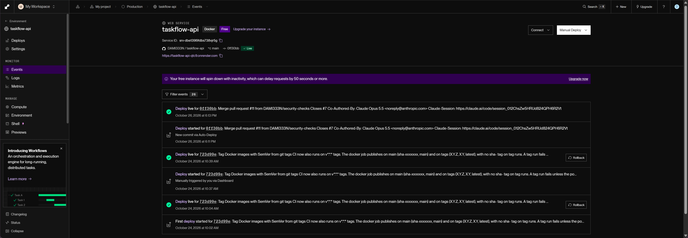
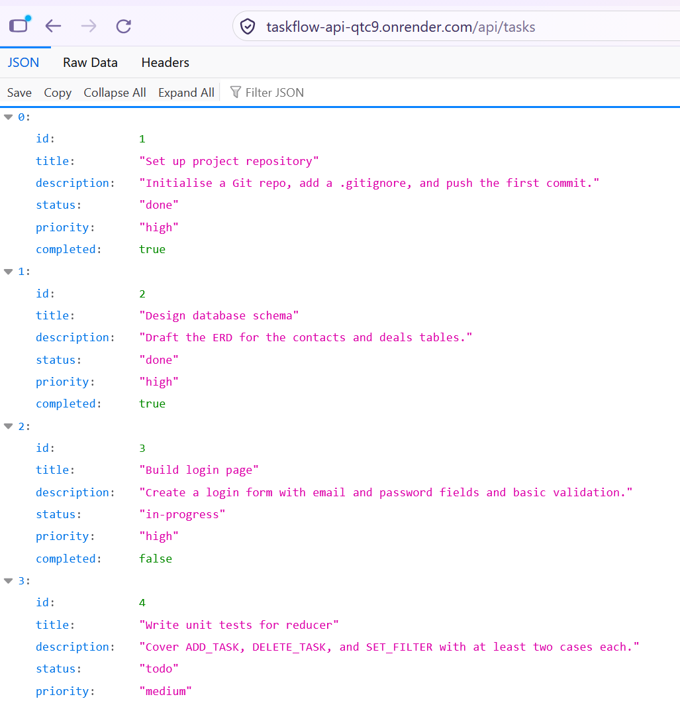
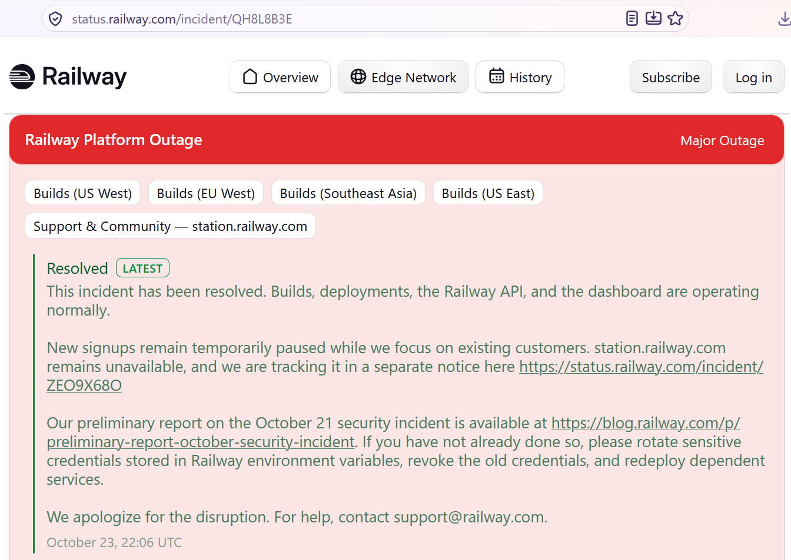
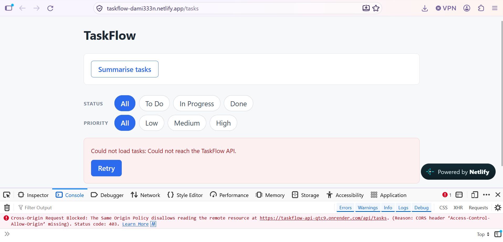
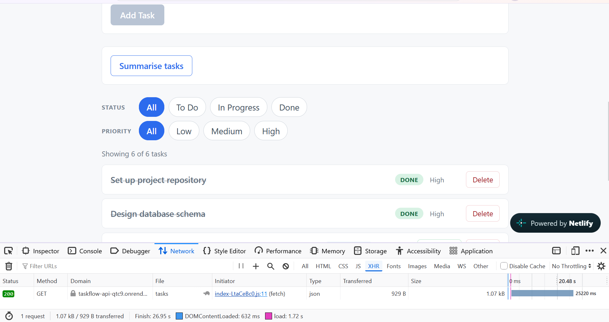
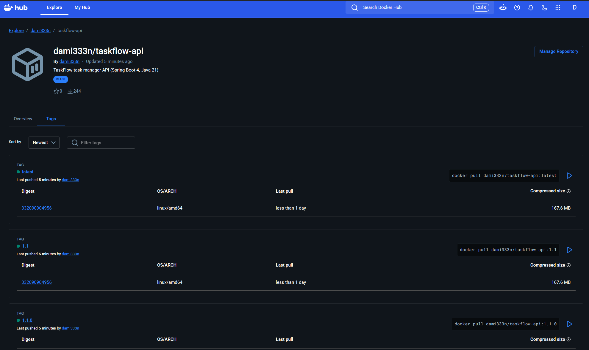

# TaskFlow API

A Spring Boot REST API for managing tasks, packaged as a Docker image, tested
and scanned in CI, published to Docker Hub and deployed as a live web service
with a React frontend on Netlify.

Built for NTU AI Engineering Course. Module 3 produced the API; Module 4 (this
submission) containerises and deploys it.

## Module 4 submission

| | |
|---|---|
| Live API | **https://taskflow-api-qtc9.onrender.com/api/tasks** (Render, standing in for Railway: see [Errors and failures](#errors-and-failures)) |
| Frontend (Option 2) | https://taskflow-dami333n.netlify.app ([source](https://github.com/DAMI333N/taskflow-web)) |
| CI pipeline (Option 1) | [run 40304952262](https://github.com/DAMI333N/taskflow-api/actions/runs/40304952262): tests, three security scans, publish |
| Docker Hub (Options 1 and 4) | [dami333n/taskflow-api](https://hub.docker.com/r/dami333n/taskflow-api) |
| Latest release | [v1.1.0](https://github.com/DAMI333N/taskflow-api/releases/tag/v1.1.0) |

The API runs on Render's free tier, which sleeps after 15 minutes without
traffic. The first request after a quiet spell takes 25 to 60 seconds; after
that it answers at once.

| Part | Status |
|---|---|
| Task 1: Dockerfile | Done, copied verbatim from the brief |
| Task 2: build and test locally | Done |
| Task 3: deploy | Done on Render, because Railway had paused new signups |
| Task 4: verify | Done, screenshots below |
| Stretch goals | Options 1, 2, 4 and 5 done (Option 3 not attempted) |

## Deployment (Tasks 1 to 4)

### Task 1: Dockerfile

[`Dockerfile`](Dockerfile) is the brief's two-stage build, unchanged: stage 1
builds the jar with Maven on `maven:3.9-eclipse-temurin-21`, stage 2 copies only
the jar onto `eclipse-temurin:21-jre-alpine`.

I added a [`.dockerignore`](.dockerignore). It keeps `target/`, `.git`, IDE
folders, screenshots, the Postman collection and any `.env*` file out of the
build context, so the context is smaller and a local secrets file can never be
copied into an image by `COPY . .`.

### Task 2: build and test locally

I keep Docker off my Windows PC, so I built and ran the image on my Ubuntu 24.04
development server (Docker 29.9.2), with the brief's commands:

```bash
docker build -t taskflow:latest .
docker run -d --name taskflow-t2 -p 127.0.0.1:8080:8080 taskflow:latest
curl http://localhost:8080/api/tasks
```

- The build took 28 seconds with the base images cached; Maven reported
  `BUILD SUCCESS`.
- The image is 176 MB as pushed to a registry. `docker image ls` reports
  499 MB because this Docker uses the containerd image store, which counts the
  compressed layers and the unpacked copy together.
- Spring Boot started in 2.9 seconds. `curl` returned HTTP 200 with the six
  seed tasks.
- `-p 127.0.0.1:8080:8080` replaces the brief's `-p 8080:8080`. On a server with
  a firewall, Docker's published ports bypass UFW, so binding to loopback keeps
  the test container off the internet.

### Task 3: deploy

Railway was not accepting new accounts during the assignment window (see
[Errors and failures](#errors-and-failures)), so I deployed the same repository
and Dockerfile to Render, which builds from a GitHub repo in the same way:

| Render setting | Value | Railway equivalent |
|---|---|---|
| Source | `DAMI333N/taskflow-api`, branch `main` | Deploy from GitHub repo |
| Runtime | Docker, using the repo's `Dockerfile` | Dockerfile detected automatically |
| Port | Environment variable `PORT=8080` | Generate Domain, port 8080 |
| Public URL | `https://taskflow-api-qtc9.onrender.com` | `*.up.railway.app` domain |
| Auto-deploy | On every commit to `main`, skipping commits that only touch docs or screenshots | Deploys on push |
| Health check | `/api/tasks` | |
| Region, plan | Singapore, Free | |

Two more environment variables are set on the service:
`TASKFLOW_CORS_ALLOWEDORIGINS` for the frontend (Option 2), and no
`OPENAI_API_KEY`, on purpose: see the 502 entry under Errors and failures.

### Task 4: verify

```bash
curl https://taskflow-api-qtc9.onrender.com/api/tasks
```

returns HTTP 200 with the six seed tasks.

Render dashboard: the service is Live on commit `0ff30bb` (release v1.1.0), with
the auto-deploy history below it.



The live application URL returning JSON:



## Errors and failures

Every task and the four stretch goals are complete. These are the problems I
hit on the way and what I did about each.

**1. Railway: new signups paused.** I could not create a Railway account. On
Railway's status page, the incident for its 21 October platform outage was
resolved on 23 October at 22:06 UTC with the note that "new signups remain
temporarily paused". I deployed to Render instead (Task 3 above). Nothing in the
code or Dockerfile is Render-specific, so the same repo deploys on Railway
unchanged once signups reopen.



**2. CORS: the frontend could not read the API.** With the frontend live on
Netlify, every request failed. The browser console showed:

```
Cross-Origin Request Blocked: The Same Origin Policy disallows reading the remote resource at
https://taskflow-api-qtc9.onrender.com/api/tasks. (Reason: CORS header 'Access-Control-Allow-Origin' missing).
Status code: 403.
```



Spring rejects a request from an origin it does not allow with a 403 and no
`Access-Control-Allow-Origin` header, which the browser reports as a missing
header. The allowed origins come from the property
`taskflow.cors.allowed-origins`, so the fix was configuration only: on Render I
set the environment variable `TASKFLOW_CORS_ALLOWEDORIGINS` (Spring's relaxed
binding maps it to that property) to
`https://taskflow-dami333n.netlify.app,http://localhost:5173,http://127.0.0.1:5173`.
Setting the variable replaces the default list, so the two local origins are
repeated in it.

**3. OWASP Dependency-Check could not download the NVD database.** The first CI
runs stalled while downloading the vulnerability database from the NVD API: one
run logged `Downloaded 10,000/413,092 (2%)` after 49 minutes, and a later one
reached 40,000 of 414,101 records when the job's 60-minute limit cancelled it.
At that rate a full download takes about 10 hours, longer than a GitHub-hosted
job may run. One cancelled run also saved a partial database to the Actions
cache. Fixes: the cache is now saved only when the job was not cancelled, and
the scan reads the Dependency-Check project's own NVD data feed mirror
(`dependency-check.github.io`) instead of the API, which takes about two minutes.

**4. Security scans failed the build.** Trivy and Dependency-Check both found
vulnerabilities. What they found and how each was handled is in
[Option 5](#option-5-security-checks).

**5. Render free tier: cold starts and an in-memory store.** After 15 idle
minutes the service sleeps, and the next request waits 25 to 60 seconds while it
starts. The frontend shows "Loading tasks..." meanwhile. Because tasks live in
memory, every restart resets the list to the six seed tasks. Both are expected
on this plan and with this design; a database (Lesson 4.10) would remove the
second.

**6. `GET /api/tasks/summary` returns 502 on the live service.** The summary
endpoint calls a language model through OpenRouter and needs `OPENAI_API_KEY`.
I chose not to put my key on a public free-tier service. Without it, OpenRouter
answers `401: Missing Authentication header`, and the API returns its designed
502 error body instead of failing:

```json
{"status":502,"message":"Could not generate a summary: 401: Missing Authentication header","timestamp":"..."}
```

Setting `OPENAI_API_KEY` on the service makes it return a summary. The key is
read from the environment and never appears in the code or the image.

## Stretch goals

The brief asks for one option. I did four: 1, 2, 4 and 5.

### Option 1: CI pipeline

GitHub Actions runs [`.github/workflows/ci.yml`](.github/workflows/ci.yml) on
every push to a branch and every `v*.*.*` tag:

| Job | What it does |
|---|---|
| Build and test | `./mvnw -B verify` on Temurin 21, 39 tests |
| Gitleaks secret scan | Scans each push for committed secrets, and the full git history on a manual run |
| OWASP Dependency-Check | Scans Maven dependencies for known CVEs |
| Trivy image scan | Builds the image and scans it for known CVEs |
| Publish image to Docker Hub | On `main` and on version tags only, after all four jobs above pass |

Docker Hub credentials are the `DOCKER_USERNAME` and `DOCKER_TOKEN` repository
secrets, never in the code. Every third-party action is pinned to a full commit
SHA, and the workflow's token is read-only. Dependabot proposes weekly updates
for the actions and the Maven dependencies.

This gives the two pipelines the brief describes, side by side: GitHub Actions
to Docker Hub, and Render's own build from the same commit to the live service.

- First successful run: [run 39737766680](https://github.com/DAMI333N/taskflow-api/actions/runs/39737766680)
  (39 tests, image pushed as `main` and `sha-0a2cfc7`)
- Latest run on `main`, with the security jobs:
  [run 40304952262](https://github.com/DAMI333N/taskflow-api/actions/runs/40304952262)
- Image on Docker Hub: [dami333n/taskflow-api](https://hub.docker.com/r/dami333n/taskflow-api)

### Option 2: frontend on Netlify

**https://taskflow-dami333n.netlify.app**, from
[DAMI333N/taskflow-web](https://github.com/DAMI333N/taskflow-web).

It is my Module 2 React task manager with its `localStorage` state replaced by
calls to this API: it lists, adds, edits, completes, deletes and filters tasks
on the live Render service, and has a button for the summary endpoint. Netlify
builds it with `VITE_API_BASE_URL` set to the Render URL, and a `_redirects`
file sends every path to `index.html` so a refresh on `/tasks/3` works. The API
allows the Netlify origin through CORS, as described in error 2 above.

Tested on 26 October on the live site: add, complete, view details, delete,
and a direct load and refresh of `/tasks/1`.



### Option 4: versioned images

Images carry two kinds of tag: a Semantic Version (MAJOR.MINOR.PATCH) for
releases, and the Git commit SHA for every build of `main`. CI applies both
automatically through `docker/metadata-action`; nothing is tagged by hand.

| Trigger | Image tags | Example |
|---|---|---|
| Push to `main` | `main`, `sha-<7-char commit>` | `main`, `sha-0ff30bb` |
| Push of tag `vX.Y.Z` | `X.Y.Z`, `X.Y`, `latest` | `1.1.0`, `1.1`, `latest` |

- `X.Y.Z` is immutable: it always means the same release.
- `X.Y` moves to the newest patch of that minor version, so `1.1` picks up a
  future `1.1.1` without the user changing anything.
- `latest` moves only on release tags, so it always points at the newest
  release and never at an untagged `main` build. Pre-release tags such as
  `v1.2.0-rc1` do not move it.
- `sha-<commit>` ties any `main` image back to the exact commit it was built
  from. Release images skip it; the git tag already names the commit.

The git tag is the single source of the version. A tag run first checks that
the `<version>` in `pom.xml` equals the tag without its `v`, and fails before
the tests and the image push if they differ. Cutting a release is:

```bash
# set <version>X.Y.Z</version> in pom.xml, commit, push, wait for green on main
git tag -a vX.Y.Z -m "vX.Y.Z"
git push origin vX.Y.Z
gh release create vX.Y.Z --generate-notes
```

Releases published so far:

- [v1.0.0](https://github.com/DAMI333N/taskflow-api/releases/tag/v1.0.0): first
  versioned release: the Module 3 API, the Dockerfile and the CI pipeline.
- [v1.1.0](https://github.com/DAMI333N/taskflow-api/releases/tag/v1.1.0):
  security scans in CI gating the publish job, and patched Tomcat and Jackson
  versions.

`latest`, `1.1` and `1.1.0` point at the same image:



### Option 5: security checks

Three scans run in CI on every push, and the image is published only when all
of them pass (see the job table in Option 1):

| Scan | Tool | Fails the build on |
|---|---|---|
| Dependencies | OWASP Dependency-Check 13.0.0 (Lesson 4.14) | Any CVE with CVSS 7.0 or higher |
| Container image | Trivy | Any CRITICAL or HIGH CVE that has a fixed version |
| Secrets | Gitleaks: each push, and the full git history on a manual run | Any secret found |

**What the scans found and what I did**

| Finding | Scan | Decision |
|---|---|---|
| Tomcat 11.0.24: 3 CRITICAL CVEs (CVE-2026-65182, CVE-2026-65905, CVE-2026-68525) | Trivy | **Fixed.** Overrode `tomcat.version` to 11.0.27 in `pom.xml`. TaskFlow uses none of the affected features (security constraints, DIGEST or FORM auth), but the fix is a patch-level bump. |
| Jackson 3.1.5 and Jackson 2.21.5: 5 HIGH CVEs, denial of service while parsing JSON | Trivy | **Fixed.** Overrode `jackson-bom.version` to 3.1.8 and `jackson-2-bom.version` to 2.21.8. The API parses untrusted request bodies, so these were reachable. |
| brotli-libs 1.2.0-r1 in the Alpine base image: CVE-2026-111497, HIGH | Trivy | **Accepted until 15 Nov 2026.** It comes from `eclipse-temurin:21-jre-alpine`, published before Alpine shipped the fix, and the Java app never calls the native brotli library. Patching it would mean changing the Dockerfile the brief specifies. Listed in [`.trivyignore`](.trivyignore) with an expiry date, after which the scan fails again if the base image is still unpatched. |
| kotlin-stdlib, kotlin-reflect: CVE-2026-53914, CVSS 9.8 | Dependency-Check | **False positive, suppressed until 31 Dec 2026.** The CVE is unsafe deserialization in Kotlin's build cache metadata, which is compiler tooling. TaskFlow compiles no Kotlin; these jars come in at runtime through Spring AI and match only because the CVE's CPE covers every Kotlin artifact. |
| spring-boot-devtools 4.1.1: CVE-2022-31691, CVSS 9.8 | Dependency-Check | **False positive, suppressed.** The CVE is in the Spring Tools IDE extensions for Eclipse and VS Code, matched by product name. Devtools is also left out of the packaged jar, so it is not in the image. |
| netty-transport 4.2.17: one MEDIUM CVE | Dependency-Check | **Left as is.** Below the CVSS 7 gate; recorded in the report. |
| Secrets | Gitleaks | **None found**, including full-history scans on 23 and 26 October. |

Each suppression records its reason in
[`dependency-check-suppressions.xml`](dependency-check-suppressions.xml). The
full Dependency-Check report is attached to every CI run as the
`dependency-check-report` artifact.

**Secrets.** The OpenRouter key is read from the `OPENAI_API_KEY` environment
variable (`spring.ai.openai.api-key=${OPENAI_API_KEY}`) and is not set on the
public deployment. The Docker Hub credentials and the NVD API key are GitHub
Actions secrets. `.env*` files are excluded by both `.gitignore` and
`.dockerignore`.

The Tomcat and Jackson overrides must come out once Spring Boot manages those
versions or newer, or they will pin old ones; Dependabot's weekly Maven updates
will show when that happens.

## Running it yourself

```bash
git clone https://github.com/DAMI333N/taskflow-api
cd taskflow-api
./mvnw spring-boot:run      # API on http://localhost:8080
./mvnw test                 # 39 unit, web-layer and integration tests
```

Or with Docker, from the published image:

```bash
docker run -p 8080:8080 dami333n/taskflow-api:1.1.0
curl http://localhost:8080/api/tasks
```

Everything works with no configuration except the summary endpoint, which needs
an OpenRouter key in `OPENAI_API_KEY` (pass it with `-e OPENAI_API_KEY` to
`docker run`). Without it, only `GET /api/tasks/summary` fails, with a 502.

| Setting | Property | Environment variable | Default |
|---|---|---|---|
| Model key | `spring.ai.openai.api-key` | `OPENAI_API_KEY` | none |
| Allowed browser origins | `taskflow.cors.allowed-origins` | `TASKFLOW_CORS_ALLOWEDORIGINS` | `http://localhost:5173,http://127.0.0.1:5173` |

A Postman collection covering every endpoint is in
`postman/TaskFlow.postman_collection.json`; import it and set `baseUrl` to
`http://localhost:8080` or the live URL.

## API reference

| Method | Path | What it does | Status |
|---|---|---|---|
| GET | `/api/tasks` | Get all tasks | 200 |
| GET | `/api/tasks/{id}` | Get one task by id | 200, 404 |
| POST | `/api/tasks` | Create a new task | 201, 400 |
| PUT | `/api/tasks/{id}` | Replace an existing task | 200, 400, 404 |
| DELETE | `/api/tasks/{id}` | Delete a task (empty body) | 200, 404 |
| PUT | `/api/tasks/{id}/complete` | Mark a task as complete | 200, 404 |
| GET | `/api/tasks/summary` | Plain-text AI summary of all tasks | 200, 502 |

A task looks like this:

```json
{
  "id": 3,
  "title": "Build login page",
  "description": "Create a login form with email and password fields and basic validation.",
  "status": "in-progress",
  "priority": "high",
  "completed": false
}
```

`title` is required. `status` is one of `todo`, `in-progress` or `done` and
defaults to `todo`; `priority` is one of `low`, `medium` or `high` and defaults
to `medium`; `description` is optional. `id` is assigned by the server and any
id sent in a request body is ignored.

```bash
curl -X POST https://taskflow-api-qtc9.onrender.com/api/tasks \
  -H 'Content-Type: application/json' \
  -d '{"title": "Write the README", "priority": "low"}'
```

### status and completed

The API carries both a three-state `status` and a `completed` flag and keeps
them consistent. `status` is the source of truth: `done` means `completed` is
`true`, anything else means `false`, whatever the request body said. When a
request leaves `status` out, it is derived from `completed`, so
`{"title": "x", "completed": true}` creates a `done` task.
`PUT /api/tasks/{id}/complete` sets both.

`PUT` replaces the whole task: fields left out of the body fall back to the
defaults above rather than keeping their previous values.

### Errors

Every error the API reports itself has the same body: 404 for an unknown id;
400 for a blank title, an unknown status or priority, a non-numeric id or
malformed JSON; 502 when the model cannot be reached.

```json
{
  "status": 404,
  "message": "Could not find task with id: 42",
  "timestamp": "2026-09-14T01:06:07.0007"
}
```

### AI summary

`GET /api/tasks/summary` renders the task list as text, sends it to the model
with a system prompt asking for one short paragraph (done first, then pending,
high-priority items by name, no bullet points) and returns the reply as
`text/plain`. Task text is injected through Spring AI's `.param()` rather than
string concatenation, so a title containing braces cannot break the prompt
template. With no tasks the endpoint answers without calling the model.

## Tech stack and project structure

- Java 21, Maven wrapper, Spring Boot 4.1.1 (Spring Web, Lombok, DevTools)
- Spring AI 2.0.1 with the OpenAI starter, pointed at OpenRouter
- JUnit 5, Mockito and MockMvc; tasks in memory, no database
- Docker (multi-stage build), GitHub Actions, Docker Hub, Render, Netlify

```
Dockerfile, .dockerignore               Task 1
.github/workflows/ci.yml                CI: test, scan, publish (Options 1, 4, 5)
.github/dependabot.yml                  weekly action and Maven updates
dependency-check-suppressions.xml       triaged Dependency-Check false positives
.trivyignore                            accepted Trivy finding, with expiry
screenshots/                            README images
src/main/java/sg/edu/ntu/taskflowapi/
  TaskflowApiApplication.java           Spring Boot entry point
  controller/TaskController             the seven endpoints
  service/TaskService                   validation, status/completed sync
  service/TaskSummaryService            builds the prompt and calls the model
  repository/TaskRepository             ArrayList storage, counter ids, seed data
  model/Task                            Lombok POJO
  exceptions/                           custom exceptions, ErrorResponse,
                                        GlobalExceptionHandler
  config/WebConfig                      CORS from taskflow.cors.allowed-origins
src/test/java/sg/edu/ntu/taskflowapi/
  service/TaskServiceTest               Mockito unit tests
  controller/TaskControllerTest         @WebMvcTest with the services mocked
  TaskFlowIntegrationTest               @SpringBootTest through the real stack
```
